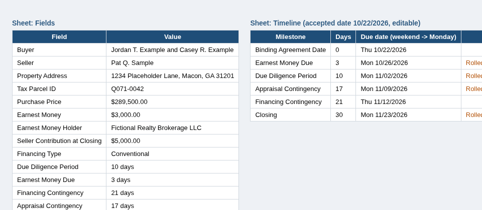

# PDF Purchase Agreement -> Excel (with key-date timeline)

A sample project. It pulls the main fields out of a real-estate purchase agreement PDF and writes them to an Excel workbook, then builds a deadline timeline from the accepted (binding agreement) date. The PDF here is fake and generated by a script; no real people or properties are involved.



## Problem
Agents and transaction coordinators retype the same numbers from every contract (buyer, seller, price, earnest money, contingency periods) and then count days on a calendar to find each deadline. That is slow and it's easy to get a date wrong, especially when one lands on a weekend.

## Features
- Extracts 15 fields (parties, address, parcel ID, price, earnest money, financing, contingency periods, closing).
- Opens password-protected PDFs with `--password`, and gives a clear message when the password is missing or wrong.
- Excel output with two sheets: `Fields` (money stored as real numbers) and `Timeline`.
- Timeline uses live Excel formulas. Change the yellow accepted-date cell and every deadline recalculates.
- Deadlines that land on Saturday or Sunday roll to the following Monday, and get flagged in a Note column.
- Lists any fields it could not find, so nothing silently goes missing.

## Usage
```bash
pip install -r requirements.txt
python make_sample.py                     # creates samples/ (plain + protected copy, password demo1234)
python extract.py samples/purchase_agreement_sample.pdf --accepted 2026-10-22 -o output/purchase_agreement.xlsx
python extract.py samples/purchase_agreement_protected.pdf --password demo1234 --accepted 2026-10-22
pytest -q                                 # 3 tests: fields, weekend roll, protected PDF
```

## Sample output
```
Extracted 15/15 fields -> output/purchase_agreement.xlsx
Milestone                  Days  Due date        Note
Binding Agreement Date        0  Thu 10/22/2026
Earnest Money Due             3  Mon 10/26/2026  Rolled from weekend to Monday
Due Diligence Period         10  Mon 11/02/2026  Rolled from weekend to Monday
Appraisal Contingency        17  Mon 11/09/2026  Rolled from weekend to Monday
Financing Contingency        21  Thu 11/12/2026
Closing                      30  Mon 11/23/2026  Rolled from weekend to Monday
```

## Notes
Real contracts vary by state and by form. The field labels live in one list (`LABELS` in `extract.py`), so adapting to a different form is mostly a matter of editing that list and the regex. Holidays are not handled in this demo, but they would be a small addition.

## Tech stack
Python 3, pdfplumber, pypdf, openpyxl, reportlab (sample generation), pytest
